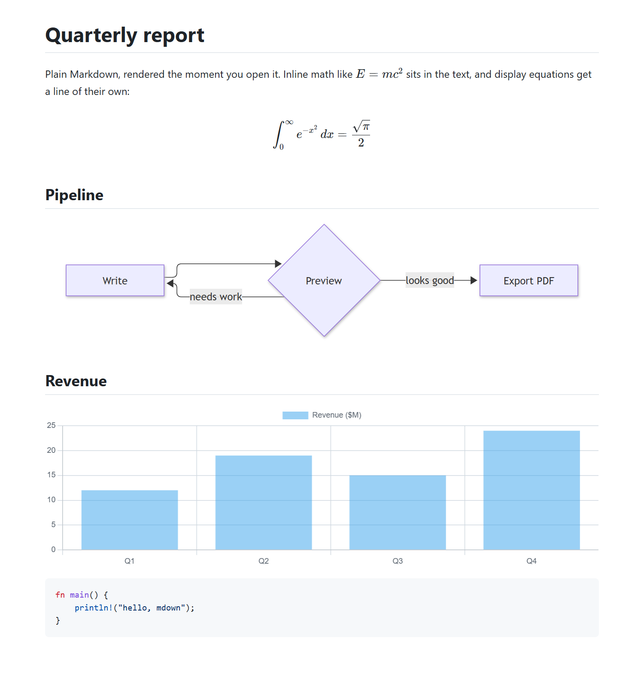
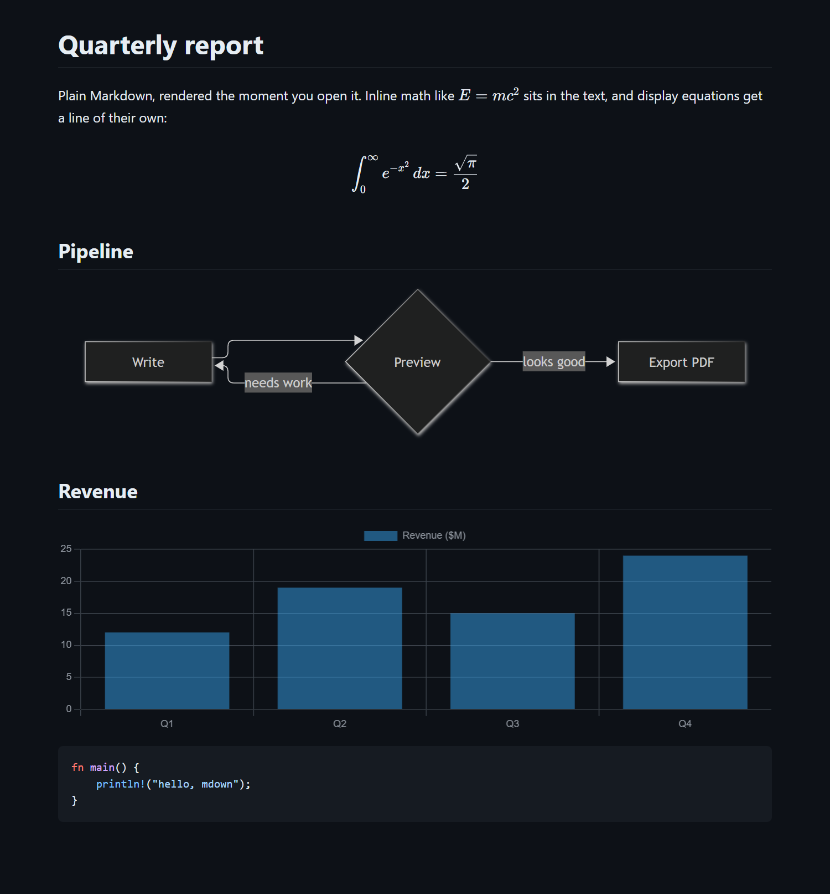
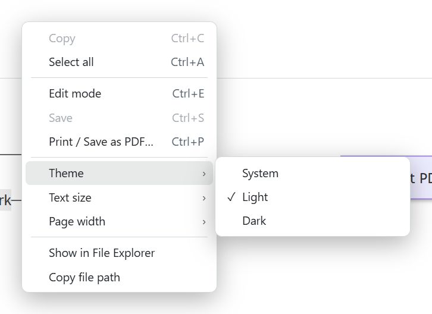

<p align="center"></p>

# mdown

A small, fast window for Markdown files. Open a `.md`, read it nicely rendered, press <kbd>Ctrl</kbd>/<kbd>⌘</kbd>+<kbd>E</kbd> to edit it with a live preview, and save it as a PDF when you're done. Every file gets its own window.

mdown is not Electron and doesn't ship a browser. It is one native Rust program that uses the web view already on your computer (WebView2 on Windows, WKWebView on macOS), so the whole viewer is a single ~8 MB program.

<p align="center">
  
  
</p>

## Install

```sh
cargo install mdown
```

Or, to skip compiling, grab a prebuilt copy with [cargo-binstall](https://github.com/cargo-bins/cargo-binstall): `cargo binstall mdown`.

Building needs [Rust](https://rustup.rs) 1.90 or newer. Either way you get two programs: `mdown` for the command line, and `mdown-app`, the window itself. Supported: **Windows 10/11** (the WebView2 runtime ships with Windows 11 and current Windows 10) and **macOS 11+**.

## Use

```sh
mdown notes.md               # open a file
mdown a.md b.md c.md         # one window each
```

Links between Markdown files open in a new window (`../` links included), links to folders, PDFs, images and text files open in their usual app, and links to anything else are shown in the file manager rather than run. Images and models resolve relative to the document, and the view updates by itself whenever the file changes on disk. If you have unsaved edits when that happens, mdown asks before replacing them.

### Open `.md` files from the file manager

`cargo install` can't ask you questions, so the first time you run `mdown` in a terminal it offers a one-time setup (and `mdown install` runs the same menu any time):

1. **Right-click menu only**: adds "Open with mdown" for `.md` files.
2. **Default app**: double-clicking a `.md` file opens it in mdown.
3. **Both.**

| | Windows | macOS |
|---|---|---|
| Right-click entry | Under *Show more options* on Windows 11 | *Open With* in Finder |
| Default app | Windows only lets *you* choose the default, so Settings opens: pick mdown for `.md` (and `.markdown`) once | mdown asks macOS to make it the default; if macOS declines, use Get Info → Open with → mdown → Change All |
| What it touches | Per-user registry keys, no admin rights | A small `~/Applications/mdown.app` it builds locally |

For scripts: `mdown install --context-menu`, `--default` or `--all`, with `--yes` to skip the question. `mdown uninstall` removes everything the setup added.

## What it renders

- **Markdown**: tables, task lists, footnotes, heading anchors, strikethrough, autolinks, front matter (hidden), and inline HTML (sanitized).
- **Code**: syntax highlighting for 28 common languages, loaded only when a document uses them.
- **Math**: `$inline$` and `$$display$$` with KaTeX.
- **Diagrams**: ```` ```mermaid ```` fences.
- **Charts**: ```` ```chart ```` fences containing a [Chart.js](https://www.chartjs.org) configuration as JSON.
- **3D models**: `` shows an interactive viewer for `.glb`, `.gltf` and `.stl` files (drag to orbit, scroll to zoom).

A block that fails (bad Mermaid, broken JSON, a missing model) shows an inline error and the rest of the page renders normally. Each of the heavier features is loaded only when the document needs it, so plain Markdown stays quick. See [`docs/showcase.md`](docs/showcase.md) for the document in the screenshots.

## Editing and PDF

<kbd>Ctrl</kbd>/<kbd>⌘</kbd>+<kbd>E</kbd> splits the window into an editor and a live preview (a CodeMirror editor with Markdown highlighting, undo history and search); press it again to go back to reading. <kbd>Ctrl</kbd>/<kbd>⌘</kbd>+<kbd>S</kbd> saves. Closing a window with unsaved edits asks first.

<kbd>Ctrl</kbd>/<kbd>⌘</kbd>+<kbd>P</kbd> opens the system print dialog, where *Save as PDF* is one of the printers. Printing always uses a clean light layout, with diagrams, charts and 3D models drawn as static images.

## Right-click menu

Right-click anywhere for copy and select-all (cut and paste in the editor), *Copy link address* and *Copy code* on links and code blocks, edit/view mode, save, print, the **theme**, **text size** and **page width** settings, *Show in File Explorer* / *Reveal in Finder*, and *Copy file path*.

<p align="center"></p>

## Keyboard shortcuts

| | |
|---|---|
| <kbd>Ctrl</kbd>/<kbd>⌘</kbd>+<kbd>E</kbd> | Toggle edit mode |
| <kbd>Ctrl</kbd>/<kbd>⌘</kbd>+<kbd>S</kbd> | Save |
| <kbd>Ctrl</kbd>/<kbd>⌘</kbd>+<kbd>P</kbd> | Print or save as PDF |
| <kbd>Ctrl</kbd>/<kbd>⌘</kbd>+<kbd>Shift</kbd>+<kbd>L</kbd> | Cycle the theme: system, light, dark |
| <kbd>Ctrl</kbd>/<kbd>⌘</kbd> + <kbd>+</kbd> / <kbd>-</kbd> / <kbd>0</kbd> | Text size larger / smaller / actual (also <kbd>Ctrl</kbd> + mouse wheel or pinch) |

## Settings

Theme, text size and page width are saved for all windows. Change them from the right-click menu, or edit `settings.json`:

| Platform | Location |
|---|---|
| Windows | `%APPDATA%\mdown\settings.json` |
| macOS | `~/Library/Application Support/mdown/settings.json` |

```json
{ "theme": "system", "width": "normal", "zoom": 1.0 }
```

`theme` is `system` (follows the OS), `light` or `dark`; `width` is `normal` or `wide`; `zoom` runs from 0.5 to 3.0. `mdown theme dark` sets the theme from the terminal. Anything invalid falls back to the default.

## Troubleshooting

- **"mdown-app is missing next to this command"**: the two programs have to stay together. Reinstall with `cargo install mdown --force`.
- **A blank window on Windows**: install the [WebView2 runtime](https://developer.microsoft.com/microsoft-edge/webview2/).
- **Windows doesn't offer mdown as the default**: run `mdown install --default` again; the *Default apps* page lists apps registered by that command.
- **macOS after upgrading**: run `mdown install` once more so `~/Applications/mdown.app` gets the new binary.
- **Remote images** in a document load from the network like in any browser; local images are only served from inside the document's git repository (never from `.git`), or from its own folder when it isn't in a repository.

## Build from source

The compiled front end is committed in `dist/`, so a normal build needs only Rust:

```sh
cargo build --release
```

To change the front end, edit `frontend/src` and run `npm install && npm run build` inside `frontend/`. `node mkicon.mjs` there regenerates the icons in `assets/`. `cargo test` runs the Rust tests.

## License

[MIT](LICENSE)
