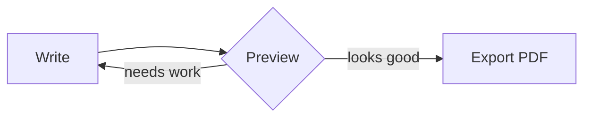

# Quarterly report

Plain Markdown, rendered the moment you open it. Inline math like $E = mc^2$ sits in the text, and display equations get a line of their own:

$$
\int_0^\infty e^{-x^2}\,dx = \frac{\sqrt{\pi}}{2}
$$

## Pipeline



## Revenue

```chart
{"type":"bar","data":{"labels":["Q1","Q2","Q3","Q4"],"datasets":[{"label":"Revenue ($M)","data":[12,19,15,24]}]},"options":{"aspectRatio":3.4}}
```

```rust
fn main() {
    println!("hello, mdown");
}
```
