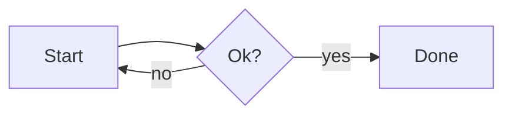
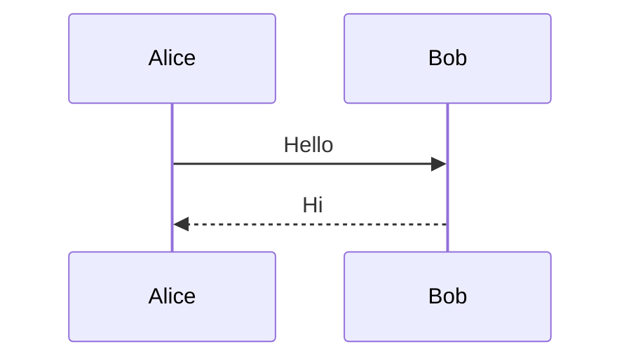

# Rich content

## Code

```rust
fn main() { println!("hello {}", 42); }
```

```python
def f(x): return [i * 2 for i in range(x)]  # comment
```

```js
const a = `t ${1 + 1}`; // js
```

```unknownlang
left alone
```

## Math

Inline $E = mc^2$ and a price of $5 and $6 stay text. Display:

$$
\int_0^\infty e^{-x^2}\,dx = \frac{\sqrt{\pi}}{2}
$$

Broken: $\frac{1$ done.

## Mermaid





```mermaid
this is not valid mermaid
```

## Charts

```chart
{"type":"bar","data":{"labels":["A","B","C"],"datasets":[{"label":"Sales","data":[3,7,4]}]}}
```

```chart
{"type":"line","data":{"labels":["x","y","z"],"datasets":[{"label":"Trend","data":[1,3,2]}]}}
```

```chart
{ not json }
```

After everything: this paragraph must still render.
